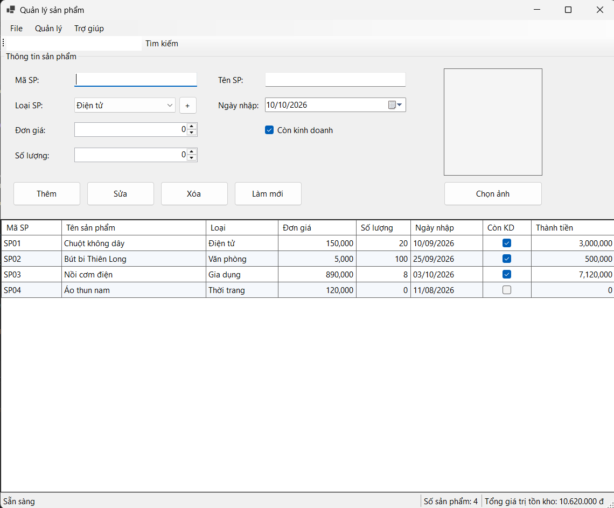
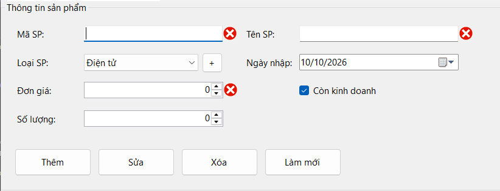
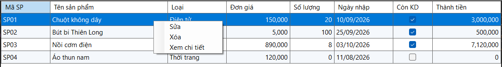
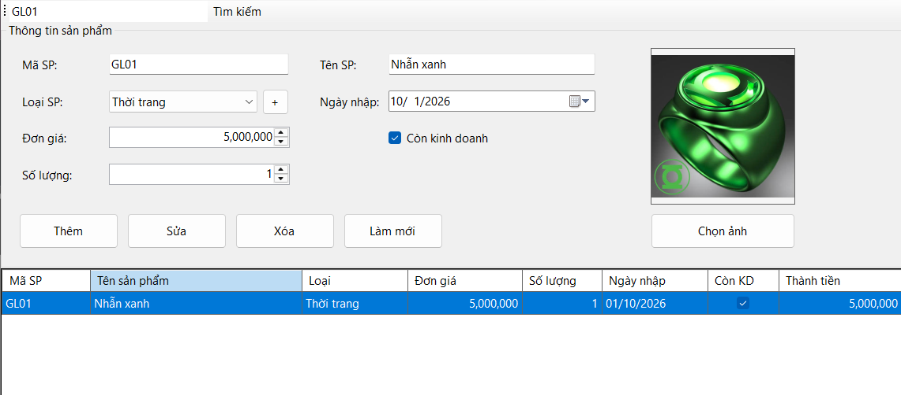
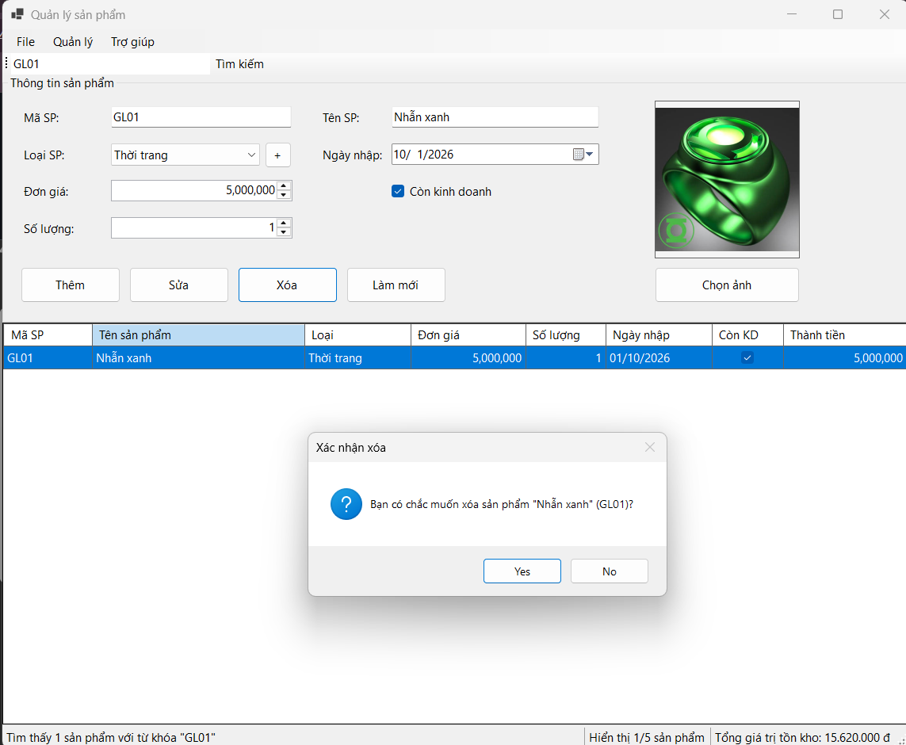
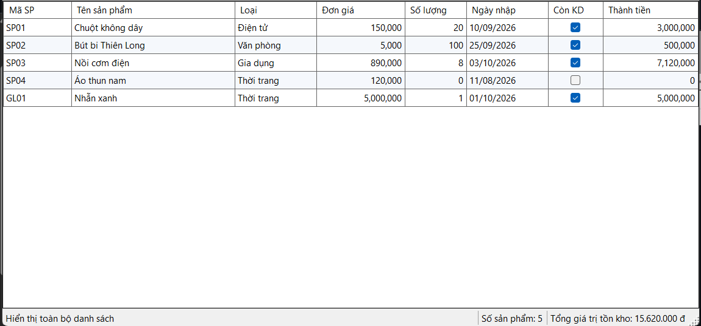

# 🚀 HỆ THỐNG QUẢN TRỊ KHO HÀNG THÔNG MINH (PRODUCT INVENTORY MANAGEMENT SYSTEM)

* **Học phần:** 2611COMP101904 - Lập trình trên Windows
* **Giảng viên hướng dẫn:** ThS. Lê Thanh Thoại
* **Sinh viên thực hiện:** Lê Quốc Tuấn - 51.01.104.115
* **Môi trường phát triển:** Microsoft Visual Studio - C# .NET Windows Forms
* **Form chính:** `FrmProduct.cs` (Giao diện Quản lý Sản phẩm)

---

## 1. Tổng quan Dự án và Điểm nhấn Kỹ thuật

Ứng dụng được thiết kế nhằm tự động hóa nghiệp vụ quản lý danh mục sản phẩm thương mại tại cửa hàng, cung cấp môi trường làm việc trực quan và an toàn tuyệt đối cho người dùng:

- **Điều hướng Đa tầng Trực quan:** Kết hợp nhịp nhàng giữa `MenuStrip` (phân chia nhóm tác vụ rõ ràng), thanh công cụ nhanh `ToolStrip` và thanh trạng thái động `StatusStrip` cập nhật liên tục biến động dữ liệu.
- **Cơ chế Binding Hai chiều (Two-Way Binding):** Tận dụng `BindingList<Product>` kết hợp `BindingSource` giúp mọi thay đổi từ giao diện lập tức phản ánh vào tập hợp bộ nhớ và ngược lại mà không cần tải lại form thủ công.
- **Ràng buộc An toàn Ô nhớ (DataGridView Hardening):** Khóa tuyệt đối các thao tác chỉnh sửa trực tiếp trên lưới (`ReadOnly = true`, `SelectionMode = FullRowSelect`), loại bỏ hoàn toàn nguy cơ phát sinh ngoại lệ do nhập liệu sai lệch cấu trúc dòng.
- **Kiểm soát Lỗi Thông minh với `ErrorProvider`:** Hệ thống tự động quét lỗi logic (trùng mã khóa chính, bỏ trống thông tin, giá trị âm, sai lệch mốc thời gian) và định vị chính xác icon cảnh báo tại control vi phạm.

---

## 2. Đặc tả Cấu trúc Thực thể Dữ liệu (`Product.cs`)

Lớp đối tượng được đóng gói chặt chẽ trong file `Product.cs`, tách biệt hoàn toàn logic lưu trữ dữ liệu và các thuộc tính tự động tính toán:

| Tên Thuộc tính | Kiểu dữ liệu | Mô tả chi tiết & Ràng buộc Nghiệp vụ |
| :--- | :--- | :--- |
| `MaSP` | `string` | Định danh duy nhất của sản phẩm, bắt buộc không rỗng, không trùng lặp. |
| `TenSP` | `string` | Tên gọi đầy đủ, không để trống, hỗ trợ hiển thị tiếng Việt có dấu. |
| `LoaiSP` | `string` | Phân loại danh mục lấy từ danh sách chọn sẵn (*Điện tử, Văn phòng, Gia dụng, Thời trang*). |
| `DonGia` | `decimal` | Mức giá bán lẻ niêm yết, yêu cầu giá trị bắt buộc lớn hơn $0$. |
| `SoLuong` | `int` | Số lượng tồn kho hiện thực, yêu cầu giá trị lớn hơn hoặc bằng $0$. |
| `NgayNhap` | `DateTime` | Mốc thời gian nhập kho, kiểm soát không được vượt quá ngày hiện tại (`DateTime.Today`). |
| `ConKinhDoanh` | `bool` | Cờ trạng thái phân phối (`True`: Đang kinh doanh, `False`: Đã ngừng). |
| `DuongDanAnh` | `string` | Đường dẫn tuyệt đối của tệp hình ảnh lưu trữ cục bộ (hỗ trợ .jpg, .png). |
| **`ThanhTien`** | `decimal` | Thuộc tính tính toán tự động tổng giá trị tồn kho của mã hàng: $\text{DonGia} \times \text{SoLuong}$. |

---

## 3. Danh mục Chức năng và Xử lý Nghiệp vụ

Hệ thống tích hợp đầy đủ các tiện ích tiêu chuẩn và nâng cao phục vụ công tác quản lý:

1. **Quản lý Hình ảnh Động qua `OpenFileDialog`:** Cho phép duyệt, chọn và nạp trực tiếp ảnh sản phẩm vào khung `PictureBox`, tự động kiểm tra sự tồn tại của tệp trên đĩa cứng khi chọn dòng dữ liệu.
2. **Hệ thống Menu Ngữ cảnh Nhanh (`ContextMenuStrip`):** Click chuột phải trực tiếp tại bất kỳ dòng nào trên bảng để mở nhanh các tùy chọn: *Cập nhật thông tin*, *Xóa bản ghi* hoặc *Xem chi tiết tổng quan*.
3. **Bộ lọc Tìm kiếm Đa năng (Search Engine):** Cho phép người dùng nhập từ khóa tìm kiếm theo cả **Mã sản phẩm** hoặc **Tên sản phẩm**, hỗ trợ lọc không phân biệt chữ hoa/thường theo thời gian thực.
4. **Tính năng Sắp xếp Dữ liệu Nâng cao:** Tích hợp tùy chọn sắp xếp danh sách sản phẩm theo thứ tự tăng/giảm dần của Đơn giá hoặc Số lượng tồn kho.
5. **Xuất Báo cáo Ra Tệp Văn bản:** Sử dụng `SaveFileDialog` để trích xuất toàn bộ danh mục sản phẩm hiện có trong bộ nhớ ra tệp `.txt` lưu trữ ngoài máy tính.
6. **Thống kê Tổng giá trị Tồn kho:** Tự động tính toán tổng giá trị tài sản đang lưu kho và hiển thị trực tiếp lên thanh trạng thái `StatusStrip`.

---

## 4. Minh chứng Thực nghiệm và Kết quả Kiểm thử (Test Cases)

Dưới đây là các hình ảnh minh chứng thực tế ghi nhận quá trình vận hành của ứng dụng được lưu trong thư mục `images/`:

### 4.1. Khởi tạo Giao diện và Tải Dữ liệu Mẫu
Ứng dụng khởi động thành công với giao diện chuẩn Desktop, tự động nạp dữ liệu mẫu lên bảng `DataGridView` và hiển thị trạng thái sẵn sàng trên thanh `StatusStrip`:

### 4.2. Kiểm soát Lỗi Dữ liệu với `ErrorProvider`
Hệ thống kích hoạt cờ cảnh báo đỏ tại các ô nhập liệu khi phát hiện vi phạm quy tắc nghiệp vụ (để trống thông tin, trùng mã định danh hoặc nhập giá trị âm):

### 4.3. Tích hợp Hộp thoại Chọn Ảnh Sản phẩm (`OpenFileDialog`)
Hộp thoại duyệt tệp giúp người dùng định vị và nạp ảnh minh họa linh hoạt, đồng thời render trực tiếp hình ảnh lên khung hiển thị:

### 4.4. Thao tác Nhanh bằng Menu Ngữ cảnh (`ContextMenuStrip`)
Menu chuột phải xuất hiện linh hoạt khi người dùng tương tác trực tiếp trên dòng dữ liệu của bảng, giúp rút ngắn thao tác gọi chức năng Sửa/Xóa:

### 4.5. Tra cứu và Trích lọc Dữ liệu Thông minh
Bộ lọc tìm kiếm xử lý chuỗi linh hoạt, lập tức cô lập các bản ghi thỏa mãn từ khóa người dùng nhập vào mà không cần khởi động lại ứng dụng:

### 4.6. Hộp thoại Xác thực An toàn (`MessageBox`)
Mọi hành động nhạy cảm như xóa bản ghi đều được bao bọc bởi hộp thoại xác nhận hai chiều nhằm triệt để ngăn chặn sự cố thao tác nhầm:

### 4.7. Đồng bộ Trạng thái và Thống kê Hệ thống (`StatusStrip`)
Thanh trạng thái dưới cùng liên tục cập nhật thông điệp phản hồi sau mỗi thao tác, đi kèm thông số chính xác về tổng số lượng bản ghi hiện có trong kho:

