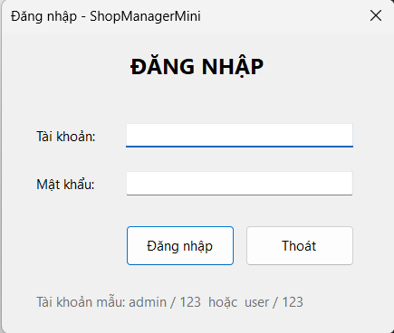
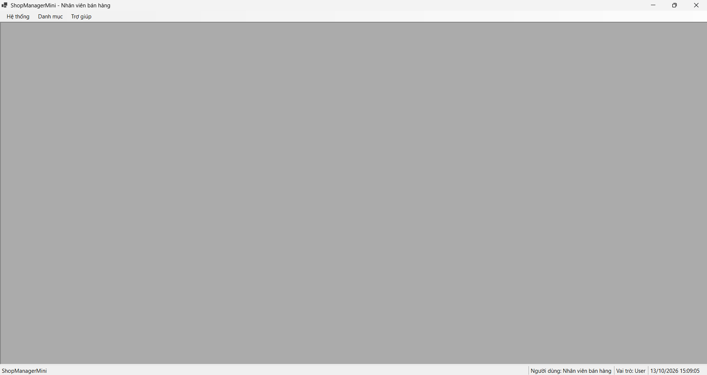
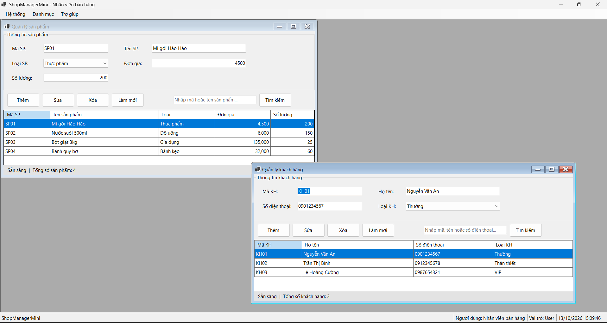
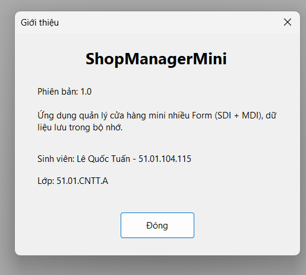
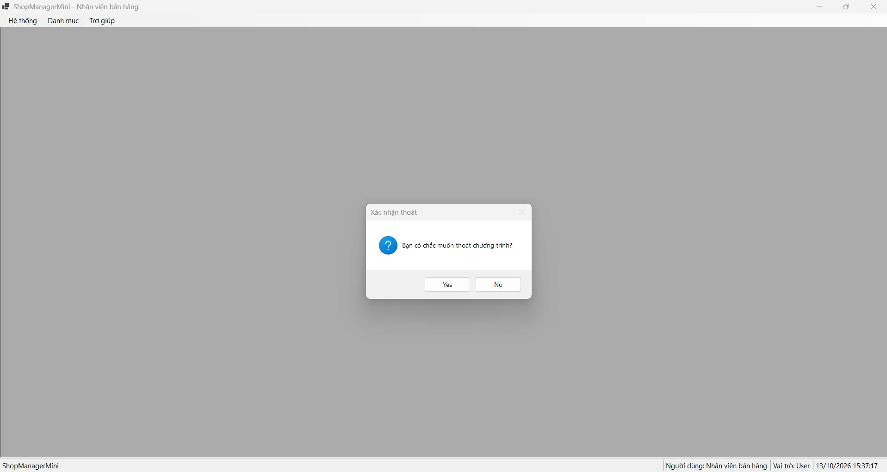
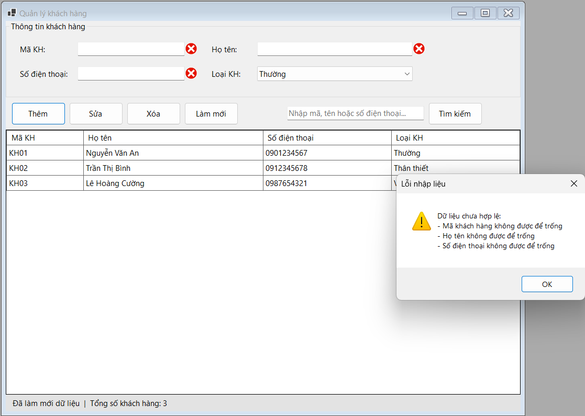
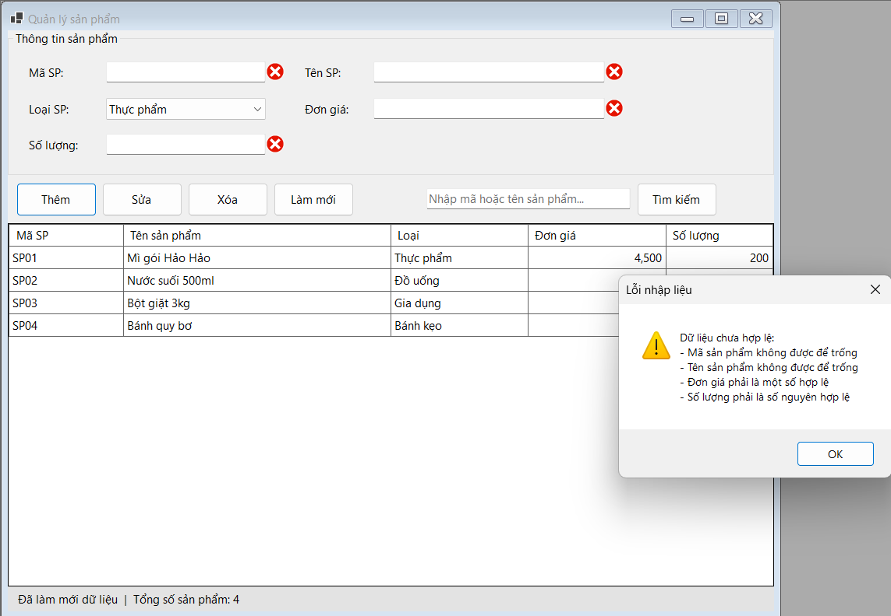
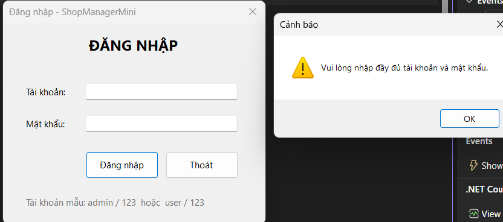

#  HỆ THỐNG QUẢN LÝ CỬA HÀNG MINI (SHOP MANAGER MINI)

* **Học phần:** 2611COMP101904 - Lập trình trên Windows
* **Giảng viên hướng dẫn:** ThS. Lê Thanh Thoại
* **Sinh viên thực hiện:** Lê Quốc Tuấn - 51.01.104.115
* **Môi trường phát triển:** Microsoft Visual Studio - C# Windows Forms App
* **Tên ứng dụng:** `ShopManagerMini`

---

## 1. Giới thiệu và Kiến trúc Hệ thống

Dự án `ShopManagerMini` được xây dựng nhằm hiện thực hóa giải pháp quản lý cửa hàng mini nhiều Form, áp dụng mô hình kiến trúc đa tài liệu MDI (Multiple Document Interface) và luồng điều khiển hướng sự kiện:

- **Mô hình kiến trúc MDI Parent - Child:** `FrmMain` đóng vai trò là Form cha chứa (`IsMdiContainer = true`), quản lý vòng đời và không gian hiển thị của các Form con bên trong vùng làm việc, ngăn chặn việc phân mảnh cửa sổ độc lập ngoài màn hình desktop.
- **Cơ chế xác thực và Điều phối luồng khởi động (Modal Authentication Flow):** Sử dụng `FrmLogin` chạy dưới dạng hộp thoại độc quyền (`ShowDialog()`). Dữ liệu người dùng được đóng gói trong đối tượng `User` và truyền sang Form chính `FrmMain` thông qua constructor.
- **Quản lý Form con đơn lẻ (Singleton Child Navigation):** Kiểm tra tập hợp `this.MdiChildren` thông qua hàm `DaMoForm(Type)` nhằm kích hoạt (`Activate()`) lại thể hiện sẵn có thay vì khởi tạo trùng lặp khi người dùng chọn menu nhiều lần.
- **Lưu trữ dữ liệu trong bộ nhớ (In-Memory Data Binding):** Toàn bộ thực thể `User`, `Product`, `Customer` được quản lý bằng cấu trúc danh sách liên kết trong bộ nhớ và đồng bộ hiển thị lên `DataGridView`.

---

## 2. Đặc tả Danh mục Form và Chức năng

| Tên Form | Vai trò kiến trúc | Trách nhiệm chức năng chính |
| :--- | :--- | :--- |
| `FrmLogin` | Modal Form | Tiếp nhận xác thực tài khoản mẫu, bẫy lỗi nhập liệu, trả `DialogResult.OK` khi hợp lệ. |
| `FrmMain` | MDI Container | Form trung tâm chứa `MenuStrip`, `StatusStrip` hiển thị định danh/vai trò người dùng và quản lý Form con. |
| `FrmProduct` | MDI Child | Quản lý danh mục sản phẩm (Thêm, Sửa, Xóa, Tìm kiếm), hiển thị `DataGridView` và bẫy lỗi ràng buộc. |
| `FrmCustomer` | MDI Child | Quản lý danh sách khách hàng, hiển thị bảng thông tin đối tác và thêm mới dữ liệu. |
| `FrmAbout` | Child Form | Hiển thị thông tin bản quyền ứng dụng, thông tin sinh viên thực hiện và lớp học phần. |

---

## 3. Minh chứng Thực nghiệm và Kiểm thử Hệ thống (Test Cases)

### 3.1. Giao diện Đăng nhập hệ thống (`FrmLogin`)
Giao diện khởi tạo màn hình đăng nhập:

### 3.2. Quản lý Không gian MDI Container (`FrmMain`)
Khởi tạo và quản lý đồng thời các Form nghiệp vụ con bên trong vùng làm việc của `FrmMain`, không mở thành các cửa sổ rời rạc:

### 3.3. Quản lý Danh mục Sản phẩm và Khách hàng
Giao diện quản lý danh mục sản phẩm và danh sách khách hàng:

### 3.4. Quản lý Danh mục Sản phẩm và Khách hàng
- Giao diện quản lý danh mục sản phẩm (thêm mới, cập nhật đơn giá, số lượng tồn kho và hiển thị trạng thái thao tác trên thanh StatusStrip):
  
  
- Giao diện quản lý danh sách khách hàng (quản lý thông tin mã, họ tên, số điện thoại và phân loại khách hàng):
  
  
  
### 3.4. Thông tin Bản quyền và Xác nhận Thao tác An toàn

Màn hình `FrmAbout` hiển thị thông tin hệ thống và định danh sinh viên:

### 3.6. Xác nhận Thoát Chương trình An toàn
Hộp thoại cảnh báo hiển thị khi người dùng bấm nút thoát hoặc đóng ứng dụng, ngăn chặn việc tắt nhầm chương trình và bảo vệ dữ liệu chưa lưu:
  

  
### 3.5. Nhóm Minh chứng Lỗi Không Nhập Thông tin (Validation & Error Handling)
Hệ thống kiểm soát chặt chẽ tính hợp lệ của dữ liệu đầu vào, kích hoạt hộp thoại cảnh báo khi người dùng bỏ trống hoặc vi phạm quy tắc nghiệp vụ:
- Cảnh báo khi bỏ trống thông tin đăng nhập:
  
  
  
- Cảnh báo yêu cầu nhập đầy đủ tài khoản và mật khẩu:
  
  
  
- Kiểm soát lỗi ràng buộc dữ liệu đầu vào tại Form Quản lý Sản phẩm (`FrmProduct`):
  
  
  
---

## 4.Câu hỏi nộp kèm

### Câu 1: SDI và MDI khác nhau như thế nào?
SDI (Single Document Interface): Mỗi Form là một cửa sổ độc lập, có các nút đóng, thu nhỏ, phóng to riêng và nằm ngang hàng với nhau trên màn hình desktop. Việc đóng Form này không ảnh hưởng đến các Form khác.

MDI (Multiple Document Interface): Gồm có một Form cha làm khung chứa tổng thể (IsMdiContainer = true). Các Form con chỉ được phép hiển thị và thao tác bên trong vùng làm việc của Form cha, không bị kéo ra ngoài màn hình độc lập. Khi đóng Form cha thì toàn bộ các Form con bên trong sẽ bị đóng theo.

### Câu 2: Vì sao Form đăng nhập nên dùng ShowDialog()?
Form đăng nhập nên sử dụng phương thức ShowDialog() thay vì Show() vì 3 lý do chính:

Chặn luồng thực thi: Ép người dùng buộc phải tương tác với Form đăng nhập và không thể bấm sang các Form khác của ứng dụng khi chưa xác thực thành công.

Cung cấp giá trị trả về (DialogResult): Cho phép chương trình kiểm tra trạng thái (OK hoặc Cancel) để quyết định có cho phép khởi chạy tiếp Form chính hay không.

Đảm bảo tính tuần tự của ứng dụng: Đảm bảo luồng khởi động chuẩn xác (đăng nhập thành công -> đóng form đăng nhập -> mở form chính FrmMain).

### Câu 3: Trong bài lab này, dữ liệu user được truyền từ FrmLogin sang FrmMain bằng cách nào?
Dữ liệu được truyền qua các bước sau:

FrmLogin lưu đối tượng user vào một property công khai (public User NguoiDung { get; private set; }) khi tài khoản và mật khẩu hợp lệ, đồng thời gán DialogResult = DialogResult.OK để đóng form.

Tại Program.cs, sau khi ShowDialog() trả về kết quả OK, chương trình đọc trực tiếp thuộc tính frmLogin.NguoiDung.

Truyền trực tiếp đối tượng này vào hàm khởi tạo (Constructor) của FrmMain: new FrmMain(frmLogin.NguoiDung, ...) để hiển thị tên và vai trò lên thanh StatusStrip.

### Câu 4: Nếu người dùng bấm menu sản phẩm nhiều lần, chương trình xử lý thế nào để không mở trùng Form?
Chương trình sử dụng một hàm kiểm tra tập hợp các Form con đang hiển thị (MdiChildren). Trước khi khởi tạo mới, hệ thống duyệt qua danh sách này, nếu phát hiện Form cùng kiểu loại đã tồn tại thì sẽ gọi lệnh kích hoạt (Activate()) và khôi phục trạng thái hiển thị (phòng trường hợp đang bị thu nhỏ) thay vì cấp phát ô nhớ mở Form mới.

### Câu 5: Khi nào nên dùng constructor, khi nào nên dùng property để truyền dữ liệu giữa các Form?
Constructor: Nên dùng khi dữ liệu là bắt buộc phải có ngay từ đầu để Form có đủ điều kiện khởi tạo và hoạt động (ví dụ: truyền thông tin user đăng nhập hoặc danh sách dữ liệu cốt lõi). Cách này giúp ràng buộc chặt chẽ từ sớm.

Property: Nên dùng khi dữ liệu có thể thay đổi sau khi Form đã được khởi tạo, hoặc khi cần lấy ngược kết quả trả về từ Form con về lại Form gọi.
