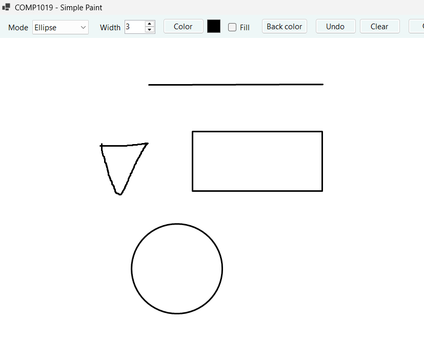
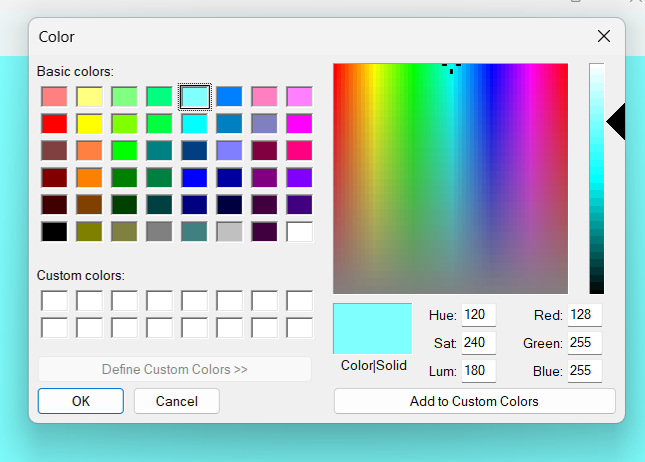
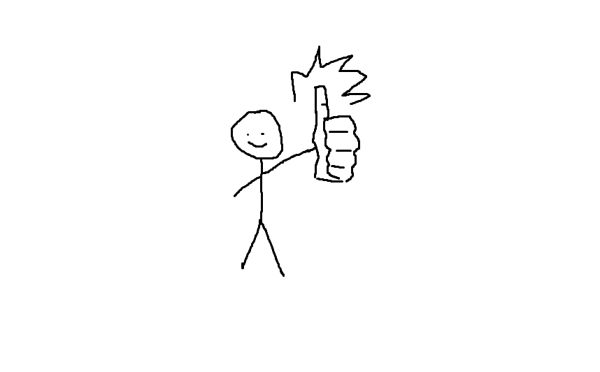
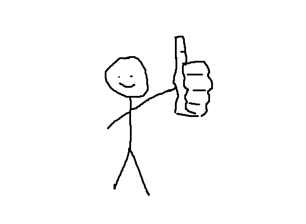
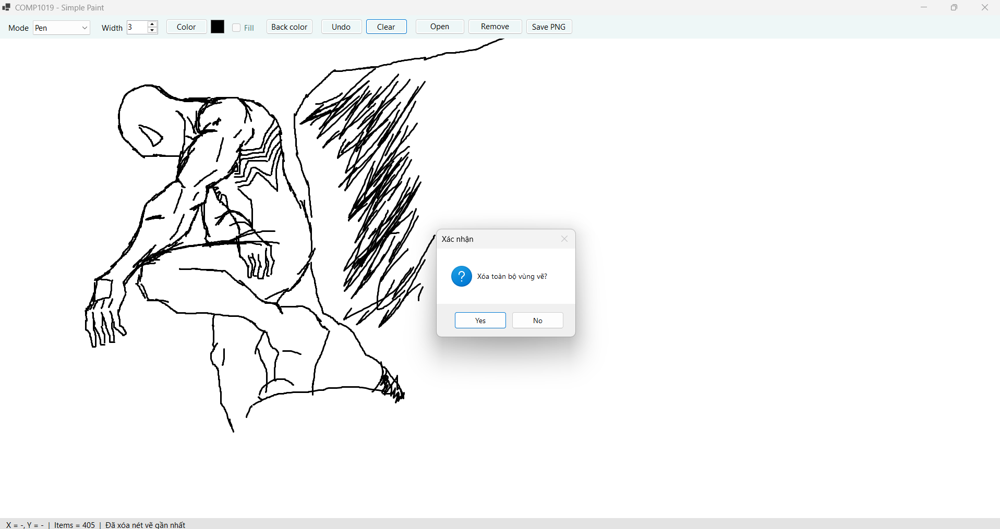
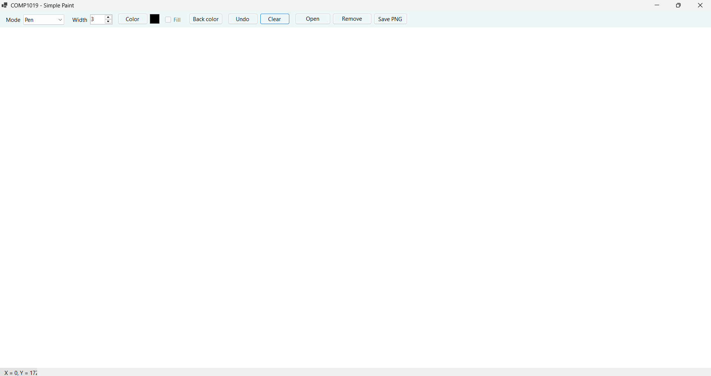
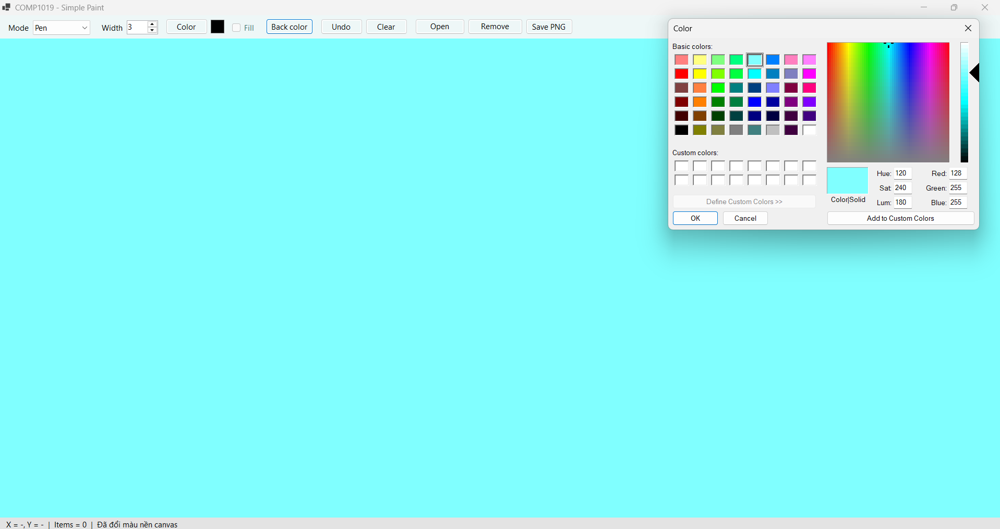
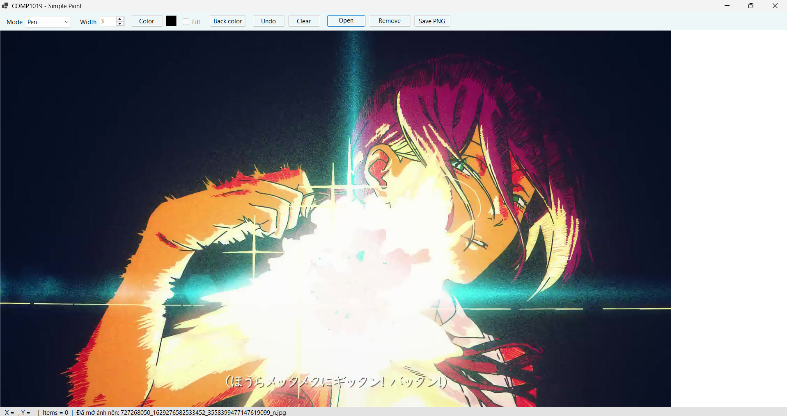
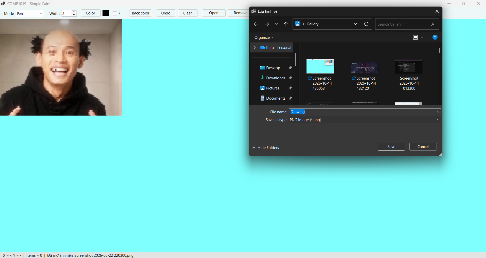
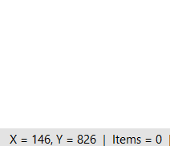

#  ỨNG DỤNG PAINT ĐƠN GIẢN (SIMPLE PAINT)

* **Học phần:** 2611COMP101904 - Lập trình trên Windows
* **Giảng viên hướng dẫn:** ThS. Lê Thanh Thoại
* **Sinh viên thực hiện:** Lê Quốc Tuấn - 51.01.104.115
* **Môi trường phát triển:** Microsoft Visual Studio - C# Windows Forms App (.NET)
* **Tên ứng dụng:** `SimplePaint`

---

## 1. Giới thiệu và Kiến trúc Hệ thống

Ứng dụng `SimplePaint` được xây dựng nhằm hiện thực hóa các kỹ thuật đồ họa 2D nâng cao trên Windows Forms bằng cách sử dụng GDI+ (`Graphics`, `Pen`, `Brush`):

- **Mô hình Quản lý Dữ liệu Gốc (`Object-Retained Rendering`):** Toàn bộ các hình vẽ được lưu trữ trong danh sách `List<DrawItem>`. Thay vì vẽ trực tiếp lên màn hình rồi mất dữ liệu, hệ thống luôn vẽ lại toàn bộ danh sách trong sự kiện `Paint` của canvas, giúp các nét vẽ không bị biến mất khi Form bị resize, thu nhỏ hoặc che khuất.
- **Tối ưu hóa Hiển thị (`DoubleBuffered Panel`):** Sử dụng `DrawSurface` (kế thừa từ `Panel` với `DoubleBuffered = true`) giúp khử hoàn toàn hiện tượng nhấp nháy màn hình khi kéo chuột tương tác liên tục.
- **Xử lý Tương tác Chuột Toàn diện:** Phối hợp nhịp nhàng các sự kiện `MouseDown`, `MouseMove`, `MouseUp` để bắt điểm đầu, preview hình theo thời gian thực (`Invalidate()`) và chốt nét vẽ khi thả chuột.
- **Quản lý Tài nguyên An toàn:** Các đối tượng đồ họa hệ thống (`Pen`) được bọc trong khối `using` để giải phóng bộ nhớ (`Dispose`) tự động, tránh rò rỉ tài nguyên.

---

## 2. Đặc tả Danh mục Thành phần Điều khiển (Controls)

| Thành phần | Tên gợi ý | Chức năng chính |
| :--- | :--- | :--- |
| `ComboBox` | `cboMode` | Chọn chế độ vẽ (`Pen`, `Line`, `Rectangle`, `Ellipse`). |
| `NumericUpDown` | `nudWidth` | Tùy chỉnh độ dày nét vẽ (phạm vi từ 1 đến 20). |
| `Button` | `btnColor` | Mở hộp thoại `ColorDialog` để chọn màu vẽ trực quan. |
| `Button` | `btnUndo` | Hoàn tác, xóa nét vẽ gần nhất khỏi danh sách. |
| `Button` | `btnClear` | Xóa sạch toàn bộ vùng vẽ sau khi có hộp thoại xác nhận. |
| `Custom Panel` | `canvas` | Vùng bề mặt vẽ chính (nền trắng, hỗ trợ DoubleBuffered). |
| `Label` | `lblStatus` | Hiển thị tọa độ chuột theo thời gian thực (`X`, `Y`) và số lượng nét vẽ. |

---

## 3. Minh chứng Thực nghiệm và Kiểm thử Chức năng (Test Cases)

### 3.1. Khởi tạo Giao diện Ứng dụng
- Giao diện trực quan với thanh công cụ điều khiển phía trên và vùng canvas rộng rãi bên dưới:
  
  

### 3.2. Vẽ thử nghiệm Đủ 4 Loại Hình
- Kiểm tra khả năng dựng hình chính xác của các chế độ: Nét tự do (`Pen`), Đoạn thẳng (`Line`), Hình chữ nhật (`Rectangle`) và Hình elip (`Ellipse`):
  
  

### 3.3. Tương tác Chọn Bảng màu (`ColorDialog`)
- Hộp thoại tùy chỉnh màu sắc nét vẽ linh hoạt:
- 
  

### 3.4. Chức năng Hoàn tác (`Undo`)
- Trước khi xóa nét vẽ lần gần nhất vẽ:
  
  
  
- Sau khi xóa nét vẽ lần gần nhất vẽ:
  
  

3.5. Chức năng Xóa Toàn bộ (`Clear`)
- Trước khi xóa hết nét vẽ:
  
  

- Sau khi xóa hết nét vẽ:

  

### 3.6. Đổi màu nền Canvas (Tính năng nâng cao)
- Tính năng cho phép thay đổi linh hoạt màu sắc phông nền của vùng vẽ theo sở thích:
  
  

### 3.7. Mở Ảnh nền để Vẽ đè (Tính năng nâng cao)
- Hỗ trợ nạp tệp hình ảnh từ bộ nhớ máy tính làm lớp nền để vẽ các đường nét GDI+ đè lên trên:
  
  

### 3.8. Xuất Bản vẽ ra Tệp Ảnh PNG (Tính năng nâng cao)
- Chức năng lưu toàn bộ nội dung đồ họa trên canvas thành file hình ảnh định dạng PNG chất lượng cao vào máy tính:
  
  

### 3.9. Sử dụng Phím tắt `Ctrl + Z` để Hoàn tác (Tính năng nâng cao)
- Hỗ trợ thao tác phím tắt bàn phím (`Ctrl + Z`) tương đương với nút Undo để rút lại nét vẽ nhanh chóng.

  

  
  
### 3.10. Theo dõi Tọa độ Chuột Thời gian thực
- Thanh trạng thái cập nhật liên tục vị trí con trỏ chuột trên vùng vẽ:
  
  
