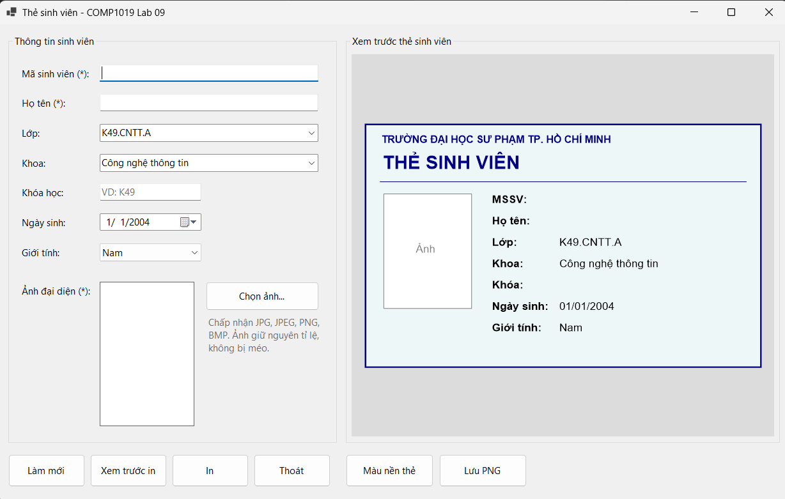
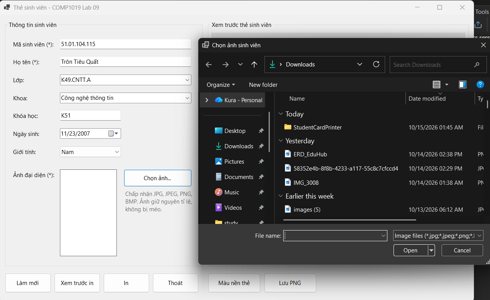
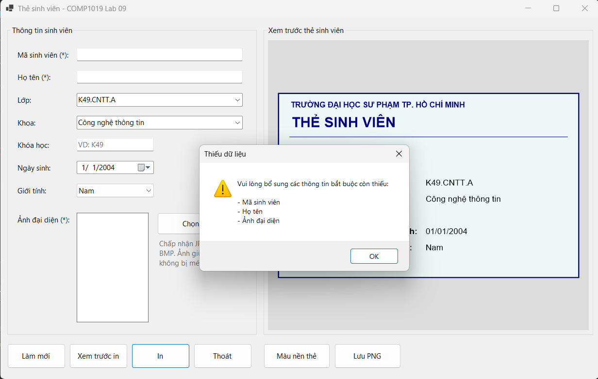
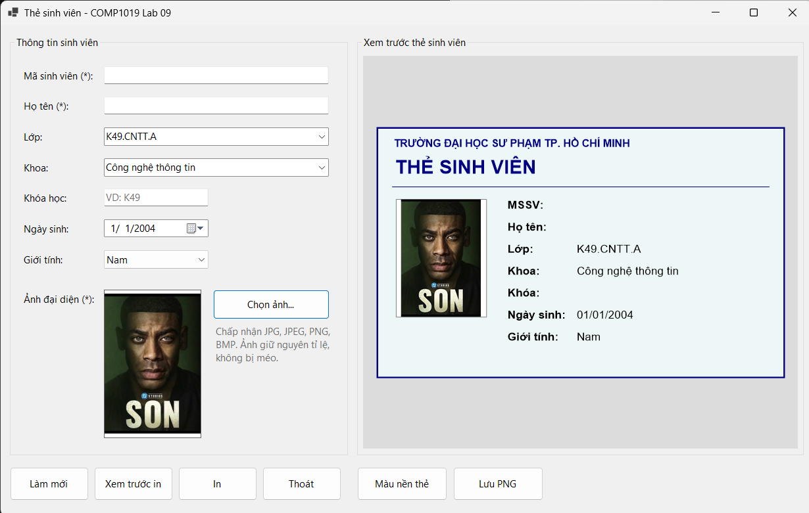
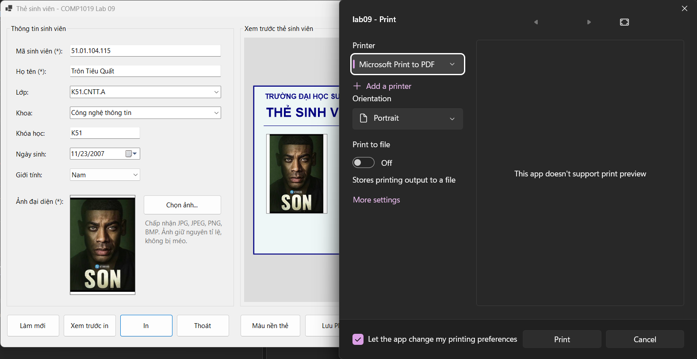
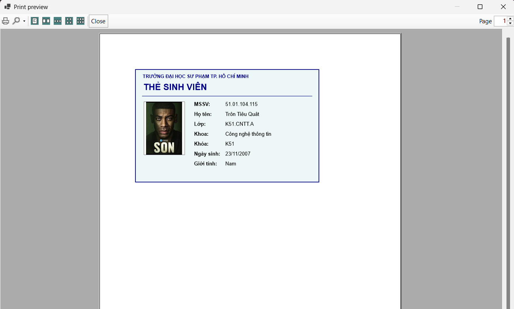
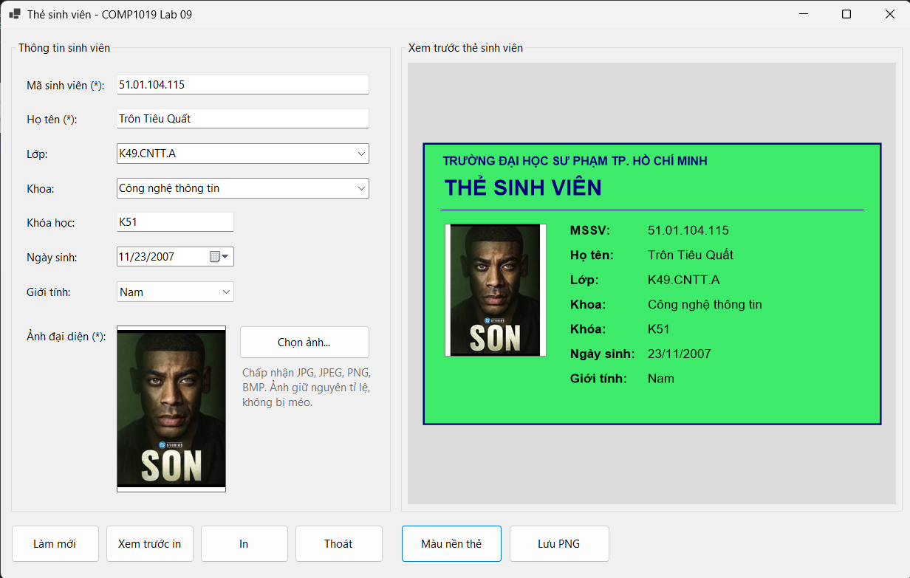
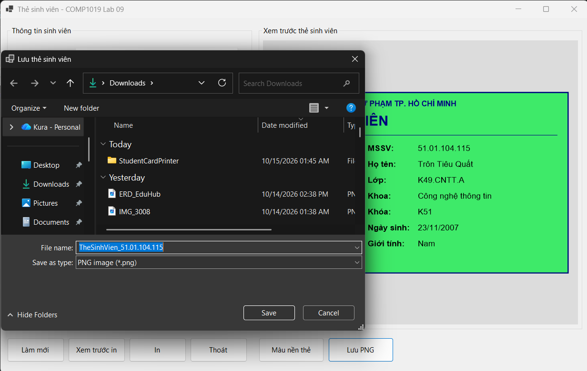

#  THIẾT KẾ VÀ IN THẺ SINH VIÊN (STUDENT CARD PRINTER)

* **Môn học:** COMP1019 - Lập trình trên Windows
* **Giảng viên hướng dẫn:** ThS. Lê Thanh Thoại
* **Sinh viên thực hiện:** Lê Quốc Tuấn - 51.01.104.115
* **Môi trường phát triển:** Microsoft Visual Studio - C# Windows Forms App (.NET), GDI+
* **Tên ứng dụng:** `StudentCardPrinter`

---

## 1. Mô tả Chức năng và Kiến trúc Hệ thống

Ứng dụng `StudentCardPrinter` được xây dựng nhằm hiện thực hóa giải pháp nhập liệu thông tin, quản lý ảnh đại diện, dựng hình preview thời gian thực và hỗ trợ in ấn chuyên nghiệp trên nền tảng .NET Windows Forms:

- **Mô hình Dữ liệu Tập trung (`StudentCardInfo`):** Tách biệt hoàn toàn tầng dữ liệu thông tin sinh viên (`StudentId`, `FullName`, `ClassName`, `Faculty`, `Course`, `BirthDate`, `Gender`, `Photo`) ra khỏi giao diện điều khiển, giúp tái sử dụng chung logic vẽ cho cả giao diện preview trên Form và bản in vật lý.
- **Xử lý Ảnh Đại diện An toàn (`OpenFileDialog & Bitmap Copy`):** Cho phép người dùng chọn các định dạng ảnh phổ biến (`JPG`, `JPEG`, `PNG`, `BMP`). Tạo bản sao đối tượng ảnh (`new Bitmap(temp)`) để tránh khóa file gốc trên ổ cứng, kết hợp thuật toán căn chỉnh tỷ lệ (`Zoom`) giúp ảnh không bị méo.
- **Xem trước Thẻ động qua GDI+ (`Panel Paint Event`):** Tự động kích hoạt phương thức vẽ lại bản xem trước (`pnlCardPreview.Invalidate()`) mỗi khi người dùng thay đổi bất kỳ trường dữ liệu hoặc hình ảnh nào trên form.
- **In ấn Chuyên nghiệp (`PrintDocument & PrintPreviewDialog`):** Tích hợp công cụ xem trước trang in trực quan và hộp thoại chọn máy in linh hoạt, đảm bảo nội dung in sắc nét, đúng bố cục tiêu chuẩn thẻ ngang.
- **Kiểm soát Dữ liệu Đầu vào (`Validation`):** Ràng buộc chặt chẽ các trường thông tin bắt buộc (Mã sinh viên, Họ tên, Ảnh đại diện) trước khi cho phép thực thi thao tác xem trước hoặc in ấn.

---

## 2. Đặc tả Danh mục Thành phần Điều khiển (Controls)

| Thành phần | Tên gợi ý | Chức năng chính |
| :--- | :--- | :--- |
| `TextBox` | `txtStudentId`, `txtFullName`, `txtCourse` | Nhập mã sinh viên, họ tên và khóa học (VD: K49). |
| `ComboBox` | `cboClass`, `cboFaculty`, `cboGender` | Chọn nhanh lớp học, khoa đào tạo và giới tính. |
| `DateTimePicker` | `dtpBirthDate` | Lựa chọn ngày tháng năm sinh sinh viên. |
| `PictureBox` | `picAvatar` | Hiển thị ảnh đại diện với chế độ căn chỉnh `Zoom`. |
| `Panel` | `pnlCardPreview` | Vùng bề mặt dựng hình xem trước thẻ sinh viên bằng GDI+. |
| `Button` | `btnChoosePhoto`, `btnClear`, `btnPreviewPrint`, `btnPrint` | Các nút chức năng chọn ảnh, làm mới form, xem trước khi in và tiến hành in. |
| `PrintDocument` | `printDocument1` | Cấu hình đối tượng và nội dung cần in trên trang giấy. |
| `PrintPreviewDialog` | `printPreviewDialog1` | Hiển thị hộp thoại xem trước trang in trước khi xuất ra máy in. |
| `PrintDialog` | `printDialog1` | Mở hộp thoại hệ thống cho phép lựa chọn máy in hoặc xuất file PDF. |

---

## 3. Minh chứng Thực nghiệm và Kiểm thử Hệ thống (Test Cases)

Hệ thống đã trải qua quá trình kiểm thử toàn diện qua 8 trường hợp kiểm thử (Test Cases) chuẩn mực:

### 3.1. Khởi tạo Giao diện Ứng dụng (`TC01`)
- Giao diện trực quan chia làm 2 vùng rõ rệt (vùng nhập liệu thông tin bên trái và vùng xem trước thẻ sinh viên bên phải):
  
  
  
### 3.3. Chọn Ảnh Đại diện qua OpenFileDialog (`TC05`)
- Cho phép người dùng mở hộp thoại chọn tệp hình ảnh (`JPG`, `PNG`, `BMP`) từ máy tính, sau đó hiển thị trực quan lên `PictureBox` theo đúng chế độ căn chỉnh tỷ lệ (`Zoom`) mà không bị méo ảnh:
  
  
  
### 3.2. Bẫy lỗi Kiểm tra Dữ liệu Bắt buộc (`TC02`, `TC03`, `TC04`)
- Hệ thống kích hoạt cảnh báo thông minh khi người dùng để trống các thông tin bắt buộc (Mã SV, Họ tên) hoặc chưa nạp ảnh đại diện trước khi in:
  
  

### 3.3. Xem trước Thẻ sinh viên bằng GDI+ (`TC05`, `TC06`)
- Khi người dùng nhập đầy đủ thông tin hợp lệ và chọn ảnh đại diện, Panel tự động vẽ hoàn chỉnh thẻ sinh viên gồm khung viền, tiêu đề trường, ảnh chân dung và các thông tin chi tiết:
  
  

### 3.4. Hộp thoại Chọn Máy in (`TC08`)
- Mở bảng điều khiển chọn thiết bị in kết nối hoặc chọn xuất file tài liệu ảo (`Microsoft Print to PDF`):
  
  

### 3.5. Cửa sổ Xem trước khi In (`TC07`)
- Hiển thị trực quan bản in hoàn chỉnh trước khi truyền dữ liệu xuống phần cứng máy in:
  
  

### 3.6. Tùy chỉnh Màu nền Thẻ (Tính năng nâng cao)
- Cho phép mở hộp thoại `ColorDialog` để thay đổi phông nền thẻ linh hoạt:
  
  

### 3.7. Lưu Thẻ dưới dạng Ảnh PNG (Tính năng nâng cao)
- Cho phép xuất file bản vẽ thẻ thành tệp hình ảnh PNG chất lượng cao thông qua `SaveFileDialog`:
  
  
  
---

## 4. Hướng dẫn Cách chạy Chương trình

1. Mở file solution dự án bằng phần mềm Microsoft Visual Studio.
2. Nhấn tổ hợp phím **`Ctrl + Shift + B`** để tiến hành biên dịch (Build) toàn bộ project.
3. Nhấn phím **`F5`** để khởi chạy ứng dụng Windows Forms.
4. Nhập đầy đủ thông tin cá nhân sinh viên, nạp ảnh đại diện từ máy tính để quan sát hình ảnh preview cập nhật trực tiếp trên Panel, sau đó sử dụng các chức năng **"Xem trước in"** hoặc **"In thẻ"**.
