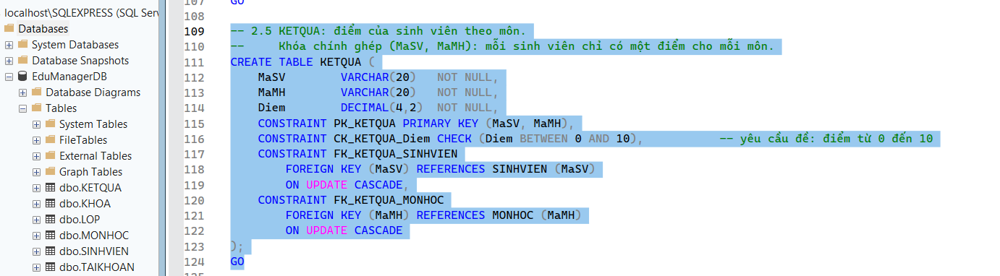
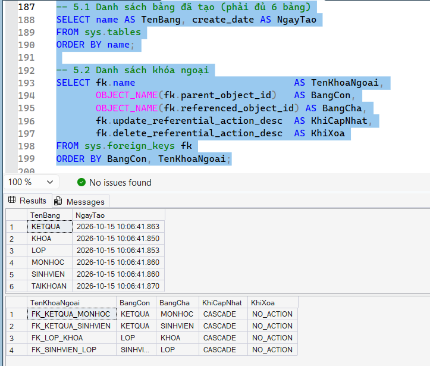
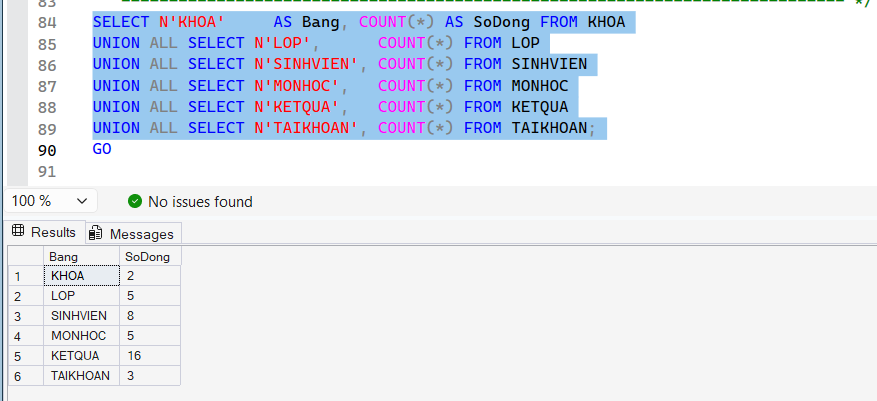
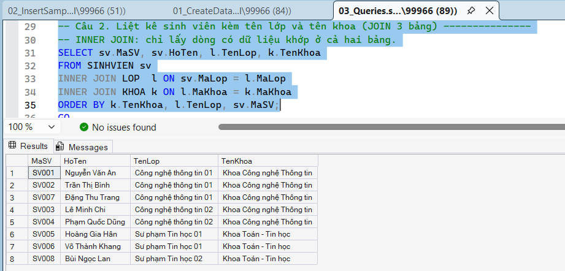
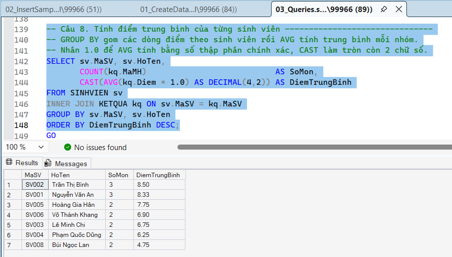
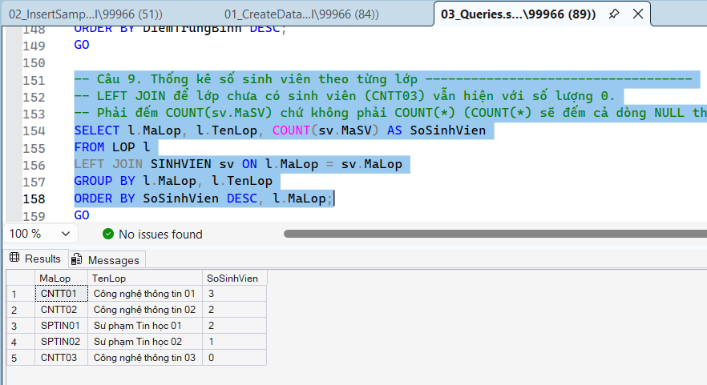
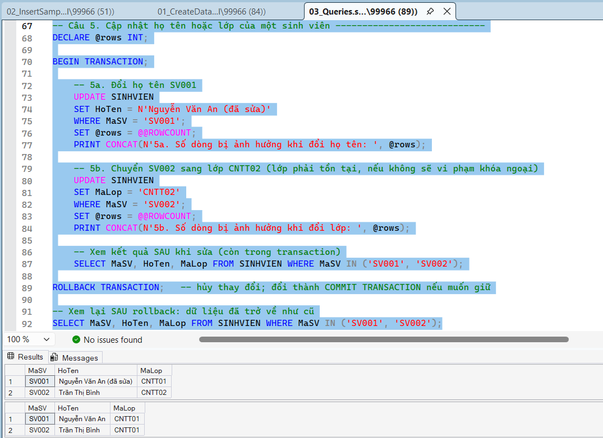
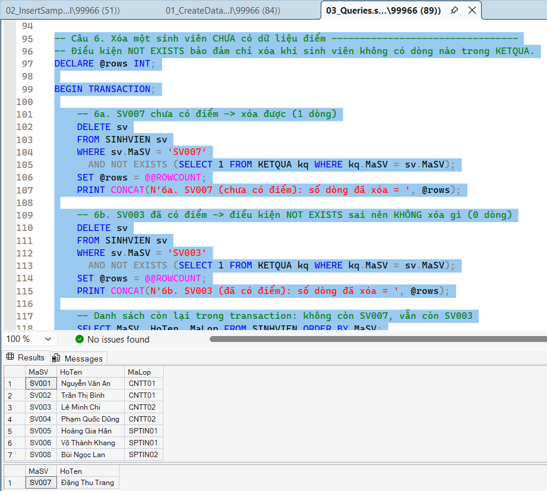
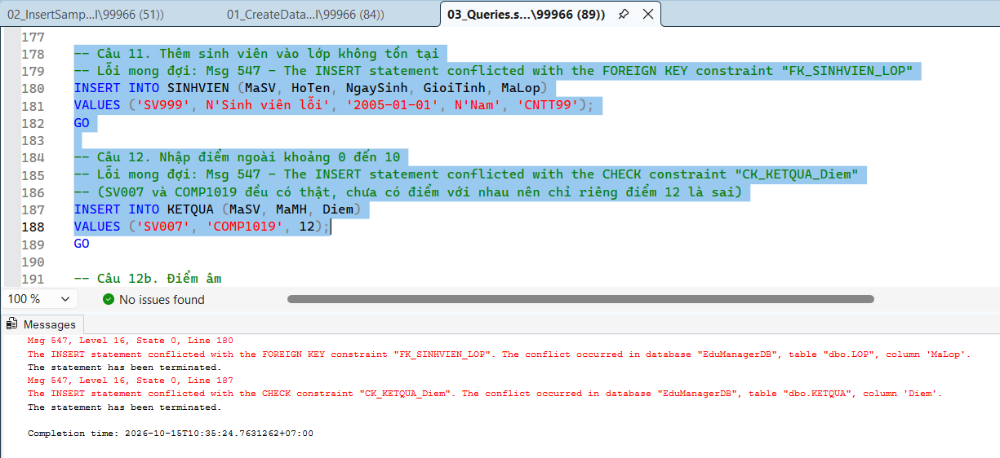
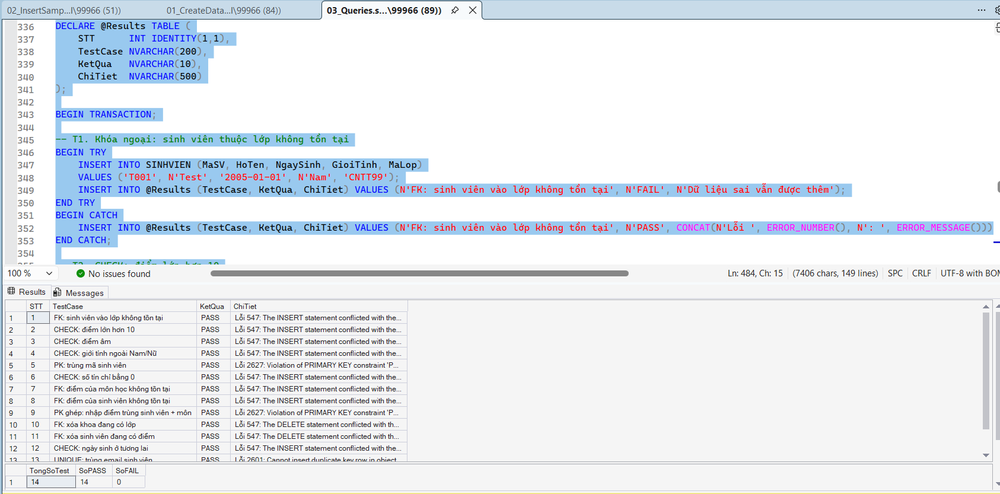

# BÁO CÁO LAB 10: THIẾT KẾ VÀ CÀI ĐẶT CƠ SỞ DỮ LIỆU EDUMANAGERDB

- **Học phần:** COMP1019 - Lập trình trên Windows
- **Giảng viên hướng dẫn:** ThS. Lê Thanh Thoại
- **Sinh viên thực hiện:** Lê Quốc Tuấn - 51.01.104.115
- **Môi trường:** Microsoft SQL Server Express (`localhost\SQLEXPRESS`) và SQL Server Management Studio (SSMS)
- **Tên CSDL:** EduManagerDB

---

## 1. Cấu trúc tệp nộp bài

- `01_CreateDatabase.sql`: Tạo CSDL `EduManagerDB`, tạo 6 bảng, thiết lập khóa chính, khóa ngoại, các ràng buộc `CHECK`/`UNIQUE`, chỉ mục và 2 view.
- `02_InsertSampleData.sql`: Nạp dữ liệu mẫu (2 khoa, 5 lớp, 8 sinh viên, 5 môn học, 16 kết quả học tập, 3 tài khoản).
- `03_Queries.sql`: Thực hiện 12 câu truy vấn theo đề (`SELECT`, `JOIN`, `LIKE`, `UPDATE`, `DELETE`, `GROUP BY`, `HAVING`), kiểm thử lỗi ràng buộc và các truy vấn bổ sung.
- `Images/`: Thư mục chứa 10 ảnh chụp kết quả chạy script.
- `README.md`: Báo cáo tóm tắt CSDL và kết quả thực nghiệm.

---

## 2. Bảng và ràng buộc toàn vẹn

| Tên bảng | Khóa chính (PK) | Khóa ngoại (FK) | Ràng buộc kiểm tra |
| :--- | :--- | :--- | :--- |
| `KHOA` | `MaKhoa` | Không | `TenKhoa` không trùng; điện thoại chỉ gồm 9-11 chữ số |
| `LOP` | `MaLop` | `MaKhoa` → `KHOA(MaKhoa)` | `TenLop` không trùng |
| `SINHVIEN` | `MaSV` | `MaLop` → `LOP(MaLop)` | **`GioiTinh IN (N'Nam', N'Nữ')`**; họ tên không rỗng; ngày sinh không ở tương lai; email đúng dạng và không trùng; số điện thoại 9-11 chữ số |
| `MONHOC` | `MaMH` | Không | **`SoTinChi > 0`**; `TenMH` không trùng |
| `KETQUA` | `(MaSV, MaMH)` | `MaSV` → `SINHVIEN(MaSV)` `MaMH` → `MONHOC(MaMH)` | **`Diem BETWEEN 0 AND 10`** |
| `TAIKHOAN` | `TenDangNhap` | Không | `VaiTro IN ('Admin', 'User')`; mặc định `VaiTro = 'User'`, `TrangThai = 1` |

Các dòng in đậm là ràng buộc bắt buộc theo đề. Các khóa ngoại dùng `ON UPDATE CASCADE` (đổi mã ở bảng cha thì bảng con đổi theo) và `ON DELETE NO ACTION` (không cho xóa bản ghi cha đang được tham chiếu).

---

## 3. Ảnh chụp minh chứng thực nghiệm

### 3.1. Tạo bảng và kiểm tra cấu trúc (file `01_CreateDatabase.sql`)

**Tạo bảng `KETQUA`** với khóa chính ghép `(MaSV, MaMH)`, ràng buộc `CHECK` điểm từ 0 đến 10 và hai khóa ngoại. Object Explorer ở bên trái cho thấy database `EduManagerDB` đã có đủ 6 bảng.

**Danh sách bảng và khóa ngoại** (mục 5.1 và 5.2 của file 01): có đủ 6 bảng và 4 khóa ngoại (`FK_KETQUA_MONHOC`, `FK_KETQUA_SINHVIEN`, `FK_LOP_KHOA`, `FK_SINHVIEN_LOP`), cập nhật theo kiểu `CASCADE`, xóa theo kiểu `NO_ACTION`.

### 3.2. Dữ liệu mẫu (file `02_InsertSampleData.sql`)

Số dòng của từng bảng sau khi nhập dữ liệu mẫu: KHOA 2, LOP 5, SINHVIEN 8, MONHOC 5, KETQUA 16, TAIKHOAN 3 (đáp ứng và vượt mức tối thiểu của đề).

### 3.3. Truy vấn liên kết bảng (Câu 2 - INNER JOIN)

Liệt kê sinh viên kèm tên lớp và tên khoa bằng cách nối 3 bảng `SINHVIEN`, `LOP`, `KHOA`. Kết quả gồm 8 sinh viên.

### 3.4. Thống kê dữ liệu gom nhóm

**Câu 8 - Điểm trung bình của từng sinh viên** (`GROUP BY`, `AVG`): SV002 cao nhất (8.50), SV008 thấp nhất (4.75). `SV007` chưa có điểm nên không xuất hiện.

**Câu 9 - Số sinh viên theo từng lớp** (`LEFT JOIN`, `COUNT`): CNTT01 có 3, CNTT02 có 2, SPTIN01 có 2, SPTIN02 có 1, CNTT03 có 0. Dùng `LEFT JOIN` nên lớp chưa có sinh viên vẫn hiển thị với số lượng 0.

**Câu 10 - Các lớp có từ 2 sinh viên trở lên** (`HAVING COUNT(sv.MaSV) >= 2`): kết quả gồm 3 lớp là CNTT01, CNTT02 và SPTIN01; lớp SPTIN02 (1 sinh viên) và CNTT03 (0 sinh viên) bị loại. Câu lệnh nằm ở dòng 161-168 của file `03_Queries.sql`.

### 3.5. Cập nhật và xóa dữ liệu

Hai câu này chạy trong `BEGIN TRANSACTION ... ROLLBACK` để xem được kết quả thay đổi mà vẫn giữ nguyên dữ liệu gốc.

**Câu 5 - UPDATE:** đổi họ tên SV001 và chuyển SV002 sang lớp CNTT02. Bảng kết quả thứ nhất (trong transaction) cho thấy dữ liệu đã đổi; bảng thứ hai (sau `ROLLBACK`) cho thấy dữ liệu đã trở về như cũ.

**Câu 6 - DELETE sinh viên chưa có điểm:** điều kiện `NOT EXISTS` bảo đảm chỉ xóa khi sinh viên không có dòng nào trong `KETQUA`. Bảng thứ nhất là danh sách trong transaction: đã mất `SV007` (chưa có điểm, xóa được) nhưng vẫn còn `SV003` (đã có điểm, không bị xóa). Bảng thứ hai cho thấy sau `ROLLBACK`, `SV007` đã trở lại.

### 3.6. Kiểm thử ràng buộc

**Câu 11 và Câu 12 - Thêm dữ liệu sai:** SQL Server báo lỗi `Msg 547` ở cả hai câu, chứng tỏ ràng buộc hoạt động đúng.

- Câu 11: thêm sinh viên vào lớp `CNTT99` không tồn tại → vi phạm khóa ngoại `FK_SINHVIEN_LOP`.
- Câu 12: nhập điểm 12 (ngoài khoảng 0-10) → vi phạm ràng buộc `CK_KETQUA_Diem`.

**Bộ kiểm thử tự động (Phần F):** 14 trường hợp nhập sai (khóa ngoại, `CHECK`, khóa chính, `UNIQUE`, xóa bản ghi đang được tham chiếu...) được chạy trong `TRY...CATCH`. Kết quả: **14/14 trường hợp PASS, 0 FAIL** (`TongSoTest = 14`, `SoPASS = 14`, `SoFAIL = 0`), nghĩa là mọi dữ liệu sai đều bị SQL Server chặn.

---

## 4. Hướng dẫn thực thi

Mở SSMS, mở từng file và thực thi bằng phím **F5** (không bôi đen) theo đúng thứ tự:
1. `01_CreateDatabase.sql`: Khởi tạo CSDL, 6 bảng, ràng buộc, chỉ mục và view. Script tự xóa database cũ nếu đã có nên chạy lại nhiều lần được.
2. `02_InsertSampleData.sql`: Nạp toàn bộ dữ liệu mẫu.
3. `03_Queries.sql`: Chạy và kiểm tra kết quả 12 câu truy vấn.

**Lưu ý:**
- Khi bôi đen riêng từng câu để chạy, cần chọn database `EduManagerDB` ở ô danh sách trên thanh công cụ (nếu để `master` sẽ báo `Invalid object name`).
- Phần D của file 03 cố ý chạy các câu sai để kiểm thử ràng buộc nên thanh trạng thái hiện "Query completed with errors" là kết quả đúng.
- Câu 5 và 6 chạy trong transaction rồi `ROLLBACK` nên dữ liệu gốc không bị thay đổi. Muốn giữ thay đổi, đổi `ROLLBACK TRANSACTION` thành `COMMIT TRANSACTION`.
